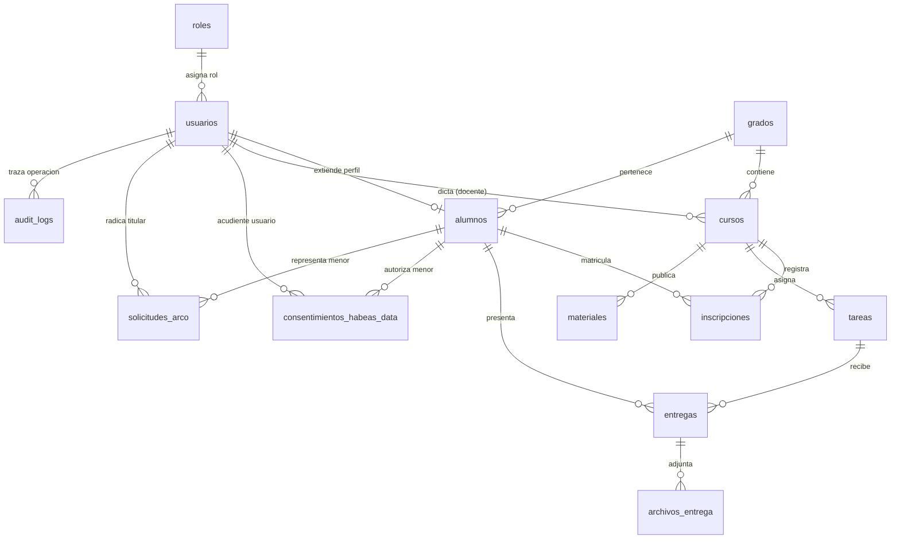

# Arquitectura de Base de Datos — LMS Primaria 🗄️

Base de datos relacional para la plataforma educativa **LMS Primaria**, implementada sobre **PostgreSQL 17.6 (Supabase Cloud)** y administrada mediante **Npgsql Entity Framework Core 8**. El diseño implementa estrictos principios de integridad referencial, indexación optimizada para despliegues serverless/container y cumplimiento normativo de la legislación colombiana (Ley 1581 de 2012, Decreto 1377 de 2013 y Ley 1098 de 2006).

---

## 🏗️ Modelo Relacional (13 Tablas en Supabase)

El esquema unificado se compone de **13 tablas** mapeadas en snake_case por la convención de persistencia:

| # | Tabla PostgreSQL | Entidad .NET Core | Descripción y Dominio |
| :-: | :--- | :--- | :--- |
| 1 | `roles` | `Rol` | Roles institucionales canónicos (`ADMINISTRADOR`, `DOCENTE`, `ALUMNO`). |
| 2 | `grados` | `Grado` | Niveles académicos de básica primaria (`1°` a `5°`). |
| 3 | `usuarios` | `Usuario` | Cuentas del sistema, autenticación, credenciales BCrypt, tokens de sesión y trazabilidad. |
| 4 | `alumnos` | `Alumno` | Perfil extendido del estudiante y su vinculación con el grado académico asignado. |
| 5 | `cursos` | `Curso` | Asignaturas/aulas vinculadas a un grado, grupo y docente titular. |
| 6 | `inscripciones` | `Inscripcion` | Matrícula activa o histórica del alumno en un curso. |
| 7 | `tareas` | `Tarea` | Actividades académicas publicadas con puntaje y fecha límite. |
| 8 | `entregas` | `Entrega` | Respuestas y soluciones enviadas por los estudiantes para su evaluación. |
| 9 | `archivos_entrega` | `ArchivoEntrega` | Metadatos y almacenamiento privado de adjuntos asociados a las entregas. |
| 10 | `materiales` | `Material` | Recursos y guías pedagógicas compartidas por los docentes en sus cursos. |
| 11 | `audit_logs` | `AuditLog` | Pista de auditoría con Row Level Security (RLS) habilitado e indexación temporal. |
| 12 | `consentimientos_habeas_data` | `ConsentimientoHabeasData` | Evidencias probatorias de consentimiento informado suscrito por acudientes/representantes legales. |
| 13 | `solicitudes_arco` | `SolicitudArco` | Radicación y seguimiento de derechos de Conocer, Actualizar, Rectificar y Suprimir (ARCO). |

---

## 📊 Diagrama Entidad-Relación (Mermaid)

---

## 📖 Diccionario de Datos — Nuevas Entidades de Privacidad y Habeas Data

### 1. `consentimientos_habeas_data` (`ConsentimientoHabeasData`)
Registra la autorización previa, expresa e informada exigida por el **Artículo 7 de la Ley 1581 de 2012** y el **Artículo 12 del Decreto 1377 de 2013** para el tratamiento de datos de niños, niñas y adolescentes (NNA), garantizando el principio de responsabilidad demostrada (*accountability*).

| Columna | Tipo de Dato | Nulo | Descripción y Reglas de Negocio |
| :--- | :--- | :-: | :--- |
| `id` | `SERIAL PRIMARY KEY` | No | Identificador único secuencial del consentimiento probatorio. |
| `alumno_id` | `INT REFERENCES alumnos(usuario_id) ON DELETE CASCADE` | No | Identificador del estudiante menor de edad sobre quien recae el tratamiento. |
| `usuario_id` | `INT REFERENCES usuarios(id) ON DELETE SET NULL` | Sí | Cuenta de usuario del acudiente si se encuentra registrado en la plataforma. |
| `acudiente_nombre` | `VARCHAR(150)` | No | Nombre y apellido completo del padre, madre o representante legal firmante. |
| `acudiente_documento`| `VARCHAR(50)` | No | Número de documento del acudiente, almacenado con enmascaramiento parcial (ej. `*******756`) para mitigar fuga de PII. |
| `tipo_documento` | `VARCHAR(20) DEFAULT 'CC'` | No | Tipo de documento de identidad del acudiente (`CC`, `CE`, `PA`, `PEP`, `PPT`). |
| `version_politica` | `VARCHAR(32)` | No | Versión formal de la política de datos vigente al momento del consentimiento (ej. `2026-10-19`). |
| `hash_texto_politica`| `VARCHAR(128)` | No | Huella digital criptográfica **SHA-256** del texto íntegro aceptado, garantizando integridad y no repudio. |
| `autoriza_servicio_educativo` | `BOOLEAN` | No | **Finalidad esencial (Obligatoria):** Gestión académica, calificaciones, tareas, semáforo escolar y matrícula. |
| `autoriza_datos_opcionales` | `BOOLEAN DEFAULT FALSE` | No | **Finalidad optativa:** Participación en actividades extracurriculares, reconocimientos públicos y eventos institucionales. |
| `autoriza_transmision_internacional` | `BOOLEAN DEFAULT FALSE` | No | Autorización expresa de transmisión transfronteriza de datos personales hacia los encargados cloud (**Supabase**, **Render**, **GitHub Pages**). |
| `ip_origen` | `VARCHAR(64)` | No | Dirección IPv4/IPv6 capturada en la firma electrónica del consentimiento. |
| `user_agent` | `VARCHAR(300)` | No | Cadena User-Agent del navegador web y sistema operativo del acudiente firmante. |
| `fecha_autorizacion_utc` | `TIMESTAMPTZ` | No | Fecha y hora exacta UTC en que se otorgó la autorización. |
| `fecha_revocatoria_utc` | `TIMESTAMPTZ` | Sí | Fecha y hora UTC de revocatoria formal. Si no es nulo, el consentimiento queda sin vigencia legal. |

**Índices asociados:**
- `idx_consentimiento_alumno` en `(alumno_id)`
- `idx_consentimiento_alumno_vigente` en `(alumno_id, fecha_revocatoria_utc)`

---

### 2. `solicitudes_arco` (`SolicitudArco`)
Gestiona los derechos constitucionales y legales de **Conocer, Actualizar, Rectificar y Suprimir** datos personales y la revocatoria de autorización, en cumplimiento de los artículos 14 y 15 de la Ley 1581 de 2012.

| Columna | Tipo de Dato | Nulo | Descripción y Reglas de Negocio |
| :--- | :--- | :-: | :--- |
| `id` | `SERIAL PRIMARY KEY` | No | Identificador único consecutivo del radicado formal ante la institución. |
| `usuario_id` | `INT REFERENCES usuarios(id) ON DELETE SET NULL` | Sí | Cuenta del usuario titular o acudiente que radica la solicitud. |
| `alumno_id` | `INT REFERENCES alumnos(usuario_id) ON DELETE SET NULL` | Sí | Identificador del estudiante cuando la solicitud es presentada por su representante legal. |
| `solicitante_nombre` | `VARCHAR(150)` | No | Nombre completo del titular o acudiente que ejerce el derecho. |
| `solicitante_documento` | `VARCHAR(50)` | No | Documento de identidad del solicitante enmascarado para seguridad probatoria. |
| `tipo_solicitud` | `VARCHAR(30)` | No | Tipo formal de derecho: `CONOCER`, `ACTUALIZAR`, `RECTIFICAR`, `SUPRIMIR`, `REVOCAR`. |
| `descripcion` | `VARCHAR(2000)` | No | Hechos, fundamentos o especificaciones del requerimiento presentado. |
| `estado` | `VARCHAR(30) DEFAULT 'RADICADA'` | No | Estado administrativo: `RADICADA`, `EN_TRAMITE`, `RESUELTA`, `RECHAZADA`. |
| `fecha_solicitud_utc` | `TIMESTAMPTZ` | No | Fecha y hora de radicación formal en el sistema (UTC). |
| `fecha_limite_legal_utc`| `TIMESTAMPTZ` | No | **Término perentorio legal:** Calculado automáticamente mediante el motor de días hábiles colombianos (Ley Emiliani + Pascua dinámica). |
| `fecha_respuesta_utc` | `TIMESTAMPTZ` | Sí | Fecha y hora de resolución formal de la solicitud. |
| `respuesta` | `VARCHAR(2000)` | Sí | Justificación o resolución adoptada notificada al solicitante. |
| `ip_origen` | `VARCHAR(64)` | Sí | IP del equipo desde el cual se originó el radicado. |

**Índices asociados:**
- `idx_solicitudes_arco_usuario` en `(usuario_id)`
- `idx_solicitudes_arco_estado_limite` en `(estado, fecha_limite_legal_utc)`

**SLA Legal Calculado:**
- **Consultas (`CONOCER` — Art. 14 Ley 1581):** `10 días hábiles`.
- **Reclamos (`ACTUALIZAR`, `RECTIFICAR`, `SUPRIMIR`, `REVOCAR` — Art. 15 Ley 1581):** `15 días hábiles`.
- Los términos excluyen sábados, domingos y los 18 festivos de la República de Colombia.

---

## 🔒 Seguridad en la Persistencia

1. **Row Level Security (RLS) en `audit_logs`:** La tabla de logs posee RLS activado (`ALTER TABLE audit_logs ENABLE ROW LEVEL SECURITY;`), impidiendo accesos no autorizados a través de la Data API directa de Supabase por usuarios anónimos.
2. **Índice Funcional Único de Usuarios:** `uq_usuarios_lower_username` sobre `LOWER(username)` garantiza unicidad insensible a mayúsculas/minúsculas y búsquedas con costo index scan O(log n).
3. **Cero Secretos en Base de Datos:** Las contraseñas se almacenan mediante hashes unidireccionales generados con **BCrypt** (work factor 12).
